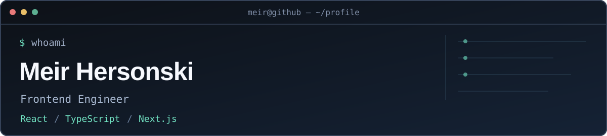

  

I build **production React applications**, data-heavy interfaces, and AI-powered web experiences.

**Current focus:** frontend architecture · user experience · AI-assisted development

### Selected work

**[AI Wig Try-On](https://github.com/Patakum/wig-tryon-ai)** — Mobile-first RTL app with AI image generation, secure uploads, and a before/after preview. · **[Live demo](https://wig-tryon-ai.vercel.app/)**

**[Android Studio Logcat Plugin](https://github.com/Patakum/AppsFlyerAndroidStudioPlugin)** — Java plugin for collecting, parsing, and filtering Android logs, developed in a four-person team.

### Stack

`React` `TypeScript` `Next.js` `Tailwind CSS` `REST APIs` `PostgreSQL` `Prisma`

---

[**Portfolio**](https://meir-hersonski.sassypark16.chatgpt.site) · [**LinkedIn**](https://www.linkedin.com/in/meir-hersonski/) · [**Email**](mailto:meirhersonski@gmail.com)
